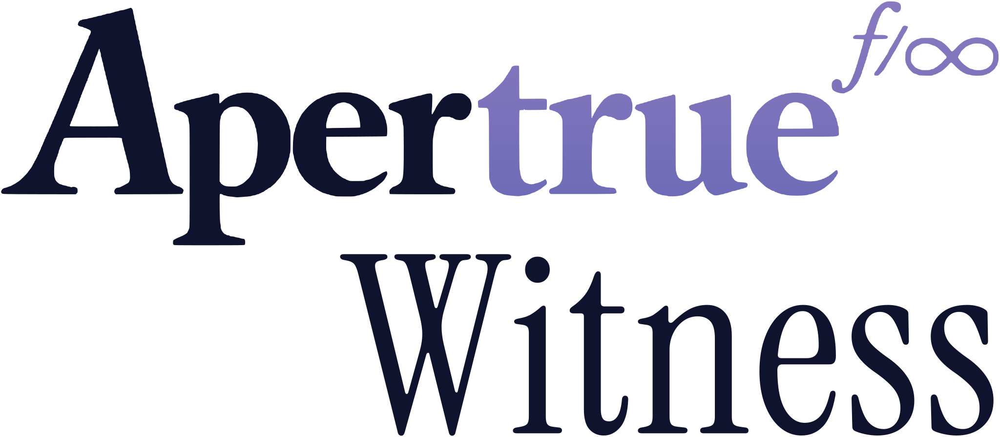
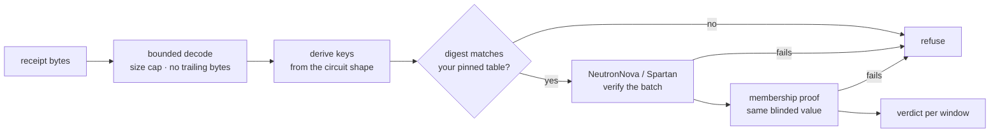
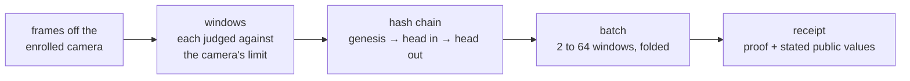

<p align="center">
  <picture>
    <source media="(prefers-color-scheme: dark)" srcset=".github/banner-dark.svg" />
    
  </picture>
</p>

<h3 align="center">witness-verify</h3>

<p align="center">
  The receipt verifier for Witness: check, in your own process or browser, that a video call's frames came off a camera registered in advance.
</p>

<p align="center">
  
  <a href="https://github.com/Apertrue/witness-verify/actions/workflows/ci.yml"></a>
  
  
  
</p>

---

## What this is

Deepfakes on video calls are getting hard to tell apart by eye. [Witness](https://witness.apertrue.photo) does not try to spot them. It proves where the video came from instead, by showing that the person on the call is using a camera they registered in advance. Each proof it produces is a receipt, and this crate is the verifier for those receipts. Anyone can run it, so nobody has to take a receipt on our word.

Every camera sensor has a physical fingerprint, a faint pattern in its pixels known in the research as photo-response non-uniformity, or PRNU. Witness measures it once, when the camera is enrolled, and each proof checks the call's frames against it, window by window, without revealing the fingerprint. [How Witness works](https://witness.apertrue.photo/how) explains it in more detail.

The crate decodes and verifies three artefacts. **Batch receipts** (version 5) are a zero-knowledge proof over a run of windows of video frames, NeutronNova multi-folded and proven with Spartan on [vega-prover](https://github.com/Apertrue/vega-prover), Apertrue's fork of Microsoft's Spartan2, over BN254 with Poseidon2. **Enrolment proofs** (version 2) show that a registry entry and its enrolment commitment describe the same sensor. **Membership proofs** (version 2) show that a camera is in the registry, a Merkle tree of depth 20, without revealing which entry is its own.

The proving library, vega-prover, is open source and pinned here, and so are the circuits. The prover in the Witness app, which turns camera frames into proofs, is not. You do not need it to check a proof, because a proof's soundness rests on the circuits and the backend, not on the prover.

## What a verified receipt shows

A verified batch receipt establishes, for each window, the verdict against the camera's committed limit, the window's picture root, and the chain head it moves from and to. It establishes for the batch that the enrolled measurements behind the blinded commitment are the ones the chain's genesis was built from. Together with the call's membership proof, which publishes the same blinded value, that means the windows came from one camera registered in advance, and reached the verifier unaltered. The verifier learns the registry root, which is public anyway, and a value that is fresh every call, so two calls from one camera publish unrelated values.

It also covers the picture of the face that the Witness verify page shows beside the call, which is taken from those same frames. Whether that face matches the sender's passport is a separate check, not part of this proof. The proof reads the camera, not the meeting app, so it says nothing about the video a meeting app shows. Video swapped into the meeting app by software, from a file or a face-swapping tool, does not reach the picture, so the check that matters is a viewer comparing that picture with the video in their meeting.

## Limits

The proof covers the camera and the picture of the face taken from its frames, nothing more. **It does not prove a live person is in front of the lens.** A deepfake can still reach a viewer three ways. A screen or a mask held in front of the enrolled camera is captured like anything else. The separate face comparison only flags it when the face shown does not look like the passport holder. A computer with its protections switched off can be fed frames ahead of the camera extension, and if they carry the enrolled sensor's pattern the check passes. The Witness verify page says separately whether Apple attests a genuine Mac with full security on, but that is Apple's statement, not part of this proof. Hardware spliced into the camera module inside the computer is beyond anything software can attest. The voice is not checked at all. Only the person using Witness is checked, and nothing here speaks for anyone else on the call.

## Try it

The [sample call](https://witness.apertrue.photo/verify/sample) opens the receipt of a real call and re-verifies it in your browser with this crate's WebAssembly build. "Now try a tampered copy" changes one character of a proof and runs the same checks again.

A receipt saved from a call is one `.json` file. Drop it on the [verification page](https://witness.apertrue.photo/verify) to check it the same way. The command-line verifiers below read the individual proofs inside it, as raw bytes.

## How verification works

Every value in a verified summary comes from the proof's own public values. A receipt may state what it proves, but only exactly, and any stated field that differs from the proof is refused.



The crate derives the key and gives you `vk_digest`. Comparing it with the digests you have pinned is up to you, and the Witness verify page does exactly that.

What a receipt covers:



Decoding is bounded before anything is allocated or derived. Receipts are bincode with fixed-width integers, capped at 4 MiB for a batch receipt and a membership proof and 8 MiB for an enrolment proof. A batch claims between 2 and 64 windows, and no key is made for a size outside that range. Bytes past the end of a receipt, or of the proof inside it, are refused, so one receipt has one encoding. Field elements must be canonical and commitment points must be on the curve.

## Quick start

The crate is not on crates.io yet. Add it as a git dependency:

```toml
witness-verify = { git = "https://github.com/Apertrue/witness-verify.git" }
```

Then:

```rust
use witness_verify::membership::{MembershipReceipt, MembershipVerifier};
use witness_verify::{BatchReceipt, BatchVerifier};

let receipt = BatchReceipt::decode(&receipt_bytes)?;
let batch = BatchVerifier::new();

// Compare with your pinned digest for this batch size before trusting a verdict.
let digest = batch.vk_digest(receipt.windows)?;

let summary = batch.verify(&receipt)?;
for v in &summary.verdicts {
    println!("window {}: passed {}, {} frames", v.window_index, v.passed, v.frames);
}

// The call's membership proof joins to the receipt by the blinded value.
let membership = MembershipVerifier::new();
let m = membership.verify(&MembershipReceipt::decode(&membership_bytes)?)?;
assert_eq!(m.blinded, summary.blinded);
// m.root is the registry root: compare it with the registry's signed root.
```

`summary.to_json()` gives the same summary as JSON, every byte string hex. Enrolment proofs verify with `enrol::EnrolReceipt::decode` and then `enrol::verify`; their keys depend on the enrolment's seed, so they are derived per enrolment from the seed the receipt carries.

A runnable version of the above, with errors handled and an exit code:

```bash
cargo run --release --example verify_call -- receipt.bin membership.bin
```

The first verification for a batch size runs key setup, which takes seconds rather than milliseconds, and the verifier keeps the keys for the rest of the process. `BatchVerifier::warm(n)` and `MembershipVerifier::warm()` do it ahead of time.

### From a terminal

The crate builds four command-line tools. Each reads its input through a byte cap, prints what the proof establishes as JSON on stdout, and answers with its exit code: 0 for valid, 1 for refused (the reason on stderr), 2 for usage or unreadable input.

```bash
cargo build --release --bins

target/release/batch_verify receipt.bin           # a batch receipt: its summary as JSON
target/release/batch_verify --vk-digest 2         # the key digest for a batch of 2 windows
target/release/membership_verify proof.bin        # a membership proof: {"root", "blinded"}
target/release/membership_verify --vk-digest      # the membership key digest
target/release/enrol_verify enrolment.bin         # an enrolment proof: {"leaf", "domain", "weightCommitment"}
echo '{"id": 1, "inputs": ["0x01", "0x02"]}' | target/release/registry_hash
```

`registry_hash` is Poseidon2 for the registry tree, one JSON request per line on stdin and one reply per line on stdout. `{"id", "inputs": [...]}` gives `{"id", "hash"}`, and `{"id", "batch": [[...], ...]}` gives `{"id", "hashes"}`. A value that is not hex, or is at or above the BN254 modulus, is an error, never a reduction.

To try one on a real receipt, `fixtures/tamper-corpus/untouched_a.bin` is a valid batch receipt and `flip_0.bin` beside it is the same receipt with one bit flipped.

The crate also carries what the prover and the verifier share: the window chain (`chain`), Poseidon2 over BN254 (`poseidon2`), the registry tree (`registry`) and the summary as JSON (`summary`).

## In the browser

The same code builds for `wasm32-unknown-unknown`. Its sibling crate, `witness-verify-wasm`, wraps it with wasm-bindgen as `warm`, `vk_digest`, `verify`, `membership_vk_digest`, `warm_membership` and `verify_membership`. The page ships about 1.5 MB of wasm and no key material, because it derives the keys itself. The Witness verify page compares each derived digest with its pinned table before it shows a verdict, then re-verifies every receipt in the viewer's own browser.

The browser build is checked against the native one over a 206-case tamper corpus: flipped proof bits, edited public values, reordered and mixed instances, proofs cut to another key, edited stated fields and non-canonical encodings. Every case must reach the same verdict in both, and an accepted receipt must give the same summary. The corpus is committed in `fixtures/tamper-corpus`, written by the Witness prover, with each case's expected verdict in `cases.tsv`; `cargo test` runs every case through the native verifier, and `witness-verify-wasm/parity.mjs` runs it through both.

### Rebuilding the page's verifier

The WebAssembly the verify page serves can be rebuilt from this repository, byte for byte:

```bash
scripts/build_wasm.sh
```

It prints the SHA-256 of `witness_verify_wasm_bg.wasm` and `witness_verify_wasm.js`. Compare them with the files attached to the [release](https://github.com/Apertrue/witness-verify/releases) and with what the page loads from `https://witness.apertrue.photo/verify/verifier/`. The build was reproduced this way on Apple silicon macOS with the pinned toolchain; other hosts have not been tried yet.

## Reproducing the pinned keys

Verifier keys are derived locally from the circuit shapes. The setup is transparent and deterministic, so there are no key files to download and no setup ceremony to trust. A change to a circuit, or to how the backend derives keys, changes the digest. To derive every key and print its digest:

```bash
cargo run --release --example vk_digests          # batch sizes 2 to 64, then membership
cargo run --release --example vk_digests -- 2     # one size
```

Compare the output with the digests Witness pins, all of which are in [PINNED_KEYS.md](PINNED_KEYS.md); CI derives every key and fails on any difference. The first batch size and the membership key are:

```
batch 2     ba75ef2b570da1a4bd5a49e388375bfbdcabd7a2bfc7e739d6b597da63b778d4
membership  92eca04116a47bf9c6afa5e1dab3041f02e71a0c12f0ba0f8213c2fa4e41d638
```

`cargo test --release` runs the crate's own 23 tests: Poseidon2 against Noir's known digest, the window chain and registry tree against shared vectors, packing against the C that defines the format, and the window verdict against the camera's limit, including that a degenerate window never passes and that a verdict cannot be flipped. It also runs the tamper corpus: every case must reach its expected verdict, an accepted receipt must give the summary the Witness prover's own verifier gave it, and a refused one must be refused for the same reason.

## Security model

The verifier trusts the circuit definitions in this repository, the vega-prover backend at the revision pinned in `Cargo.toml`, halo2curves for BN254, and the standard Poseidon2 parameters (generated by Horizen Labs), which match the published copy in Aztec's barretenberg library at a pinned revision, all 260 values in order.

It does not trust the Witness service, the network between it and you, or the prover. A receipt is checked as bytes from an adversary. The service carries the evidence between the call and you, and has no say in whether it verifies.

The crate checks that a camera is in the registry under a given root, but not that the root is the registry's published one. The Witness verify page does that, against the registry's signed root and its public log, cosigned by independent witnesses.

## Status

Version 0.1.0, so the API may change before 1.0. In October 2026 the circuits and this verifier were reviewed internally, with two AI code reviewers, and the findings were fixed. An external audit has not yet been done.

## Contributing

Issues and pull requests are welcome. Please report anything security-related privately, as below.

## Reporting a vulnerability

Please report privately. See [SECURITY.md](SECURITY.md).

## Licence

Licensed under the [Apache License, Version 2.0](LICENSE). Copyright 2026 Apertrue Ltd.

The Poseidon2 parameters match Aztec's barretenberg, licensed under Apache 2.0, and the backend, vega-prover, is a fork of Microsoft's Spartan2, licensed under MIT. Both notices are in [THIRD_PARTY_NOTICES.md](THIRD_PARTY_NOTICES.md).

Unless you state otherwise, any contribution you submit for inclusion in this repository is licensed as above, without additional terms or conditions.

## About Apertrue

Built by [Apertrue](https://apertrue.photo), the makers of [Witness](https://witness.apertrue.photo).
