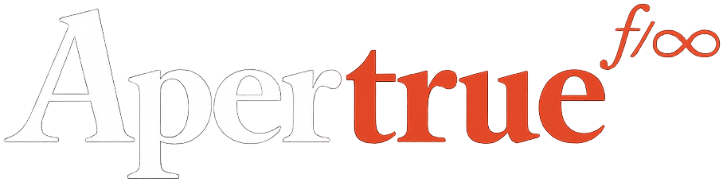
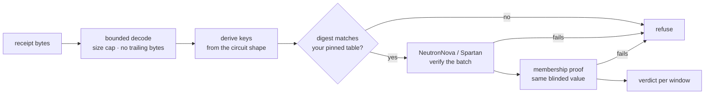
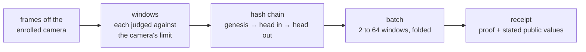

<p align="center">
  
</p>

<h3 align="center">witness-verify</h3>

<p align="center">
  The receipt verifier for Witness: check, in your own process or browser, that a video call's frames came off a camera registered in advance.
</p>

<p align="center">
  <!-- Switch to Apache 2.0 once the licence is chosen: https://img.shields.io/badge/license-Apache%202.0-blue -->
  
  
  
  
  
</p>

---

## What this is

[Witness](https://witness.apertrue.photo) proves, during a video call, that the person on camera is using a camera they registered in advance. Each proof it produces is a receipt, and this crate is the verifier for those receipts: anyone can run it, so a Witness receipt never has to be taken on trust, ours or the service's. It decodes and verifies three artefacts. **Batch receipts** are a zero-knowledge proof over a run of windows of video frames, NeutronNova multi-folded and proven with Spartan on vega-prover, Apertrue's fork of Microsoft's Spartan2, over BN254 with Poseidon2. **Enrolment proofs** show that a registry entry and its enrolment commitment describe the same sensor. **Membership proofs** show that a camera is in the registry, a Merkle tree of depth 20, without revealing which entry is its own. The prover is not in this repository and does not need to be: a proof's soundness does not depend on the prover being secret, only on the circuits and the backend, and both are here or pinned here.

## What a receipt proves, and what it does not

A verified batch receipt establishes, for each window, the verdict against the camera's committed limit, the window's picture root, and the chain head it moves from and to. It establishes for the batch that the enrolled measurements behind the blinded commitment are the ones the chain's genesis was built from. Together with the call's membership proof, which publishes the same blinded value, that means the windows came from one camera registered in advance, and reached the verifier unaltered. The verifier learns the registry root, which is public anyway, and a value that is fresh every call, so two calls from one camera publish unrelated values.

The proof covers the camera and the face in the ring (the picture the Witness verify page shows beside the call), nothing more. Video swapped into the meeting by software, from a file or a face-swapping tool, never touches it, because the proof reads the camera and not the meeting app.

**The proof does not prove a live person is in front of the lens.** A deepfake can still reach a viewer three ways. A screen or a mask held in front of the enrolled camera is captured like anything else. A computer with its protections switched off can be fed frames ahead of the camera extension, and if they carry the enrolled sensor's pattern the check passes. Hardware spliced into the camera module inside the computer is beyond anything software can attest. The voice is not checked at all. Only the person using Witness is checked, and nothing here speaks for anyone else on the call.

## How verification works

Every value in a verified summary comes from the proof's own public values. A receipt may state what it proves, but only exactly: any stated field that differs from the proof is refused.



The digest comparison is yours to make: the crate derives the key and gives you `vk_digest`, and a deployment compares it with the digests it has pinned. The Witness verify page does exactly that.

What a receipt covers:



Decoding is bounded before anything is allocated or derived. Receipts are bincode with fixed-width integers, capped at 4 MiB for a batch receipt and a membership proof and 8 MiB for an enrolment proof. A batch claims between 2 and 64 windows, and no key is made for a size outside that range. Bytes past the end of a receipt, or of the proof inside it, are refused, so one receipt has one encoding. Field elements must be canonical and commitment points must be on the curve.

## Quick start

The crate is not on crates.io yet. Add it as a git dependency, then:

```rust
use witness_verify::membership::{MembershipReceipt, MembershipVerifier};
use witness_verify::{BatchReceipt, BatchVerifier};

let receipt = BatchReceipt::decode(&receipt_bytes)?;
let batch = BatchVerifier::new();

// Compare with your pinned digest for this batch size before trusting a verdict.
let digest = batch.vk_digest(receipt.windows)?;

let summary = batch.verify(&receipt)?;
for v in &summary.verdicts {
    println!("window {}: passed {}, {} frames", v.window_index, v.passed, v.frames);
}

// The call's membership proof joins to the receipt by the blinded value.
let membership = MembershipVerifier::new();
let m = membership.verify(&MembershipReceipt::decode(&membership_bytes)?)?;
assert_eq!(m.blinded, summary.blinded);
// m.root is the registry root: compare it with the registry's signed root.
```

`summary.to_json()` gives the same summary as JSON, every byte string hex. Enrolment proofs verify with `enrol::EnrolReceipt::decode` and then `enrol::verify`; their keys depend on the enrolment's seed, so they are derived per enrolment from the seed the receipt carries.

A runnable version of the above, with errors handled and an exit code:

```bash
cargo run --release --example verify_call -- receipt.bin membership.bin
```

The first verification for a batch size runs key setup, which takes seconds rather than milliseconds, and the verifier keeps the keys for the rest of the process. `BatchVerifier::warm(n)` and `MembershipVerifier::warm()` do it ahead of time.

The crate also carries what the prover and the verifier share: the window chain (`chain`), Poseidon2 over BN254 (`poseidon2`), the registry tree (`registry`) and the summary as JSON (`summary`).

## In the browser

The same code builds for `wasm32-unknown-unknown`. Its sibling crate, `witness-verify-wasm`, wraps it with wasm-bindgen as `warm`, `vk_digest`, `verify`, `membership_vk_digest`, `warm_membership` and `verify_membership`. The page ships about 1.5 MB of wasm and no key material, because it derives the keys itself. The Witness verify page compares each derived digest with its pinned table before it shows a verdict, then re-verifies every receipt in the viewer's own browser.

The browser build is checked against the native one over a 206-case tamper corpus: flipped proof bits, edited public values, reordered and mixed instances, proofs cut to another key, edited stated fields and non-canonical encodings. Every case must reach the same verdict in both, and an accepted receipt must give the same summary.

## Reproducing the pinned keys

Verifier keys are derived locally from the circuit shapes. The setup is transparent and deterministic, so there is nothing to download and nothing to trust about who ran it. A change to a circuit, or to how the backend derives keys, changes the digest. To derive every key and print its digest:

```bash
cargo run --release --example vk_digests          # batch sizes 2 to 64, then membership
cargo run --release --example vk_digests -- 2     # one size
```

Compare the output with the digests Witness pins. The first batch size and the membership key are:

```
batch 2     ba75ef2b570da1a4bd5a49e388375bfbdcabd7a2bfc7e739d6b597da63b778d4
membership  92eca04116a47bf9c6afa5e1dab3041f02e71a0c12f0ba0f8213c2fa4e41d638
```

`cargo test` runs the crate's own 23 tests: Poseidon2 against Noir's known digest, the window chain and registry tree against shared vectors, packing against the C that defines the format, and the window verdict against the camera's limit, including that a degenerate window never passes and that a verdict cannot be flipped.

## Security model

Trusted: the circuit definitions in this repository; the vega-prover backend at the revision pinned in `Cargo.toml`; halo2curves for BN254; the Poseidon2 parameters, which match Aztec's barretenberg reference at a pinned revision, all 260 values in order.

Not trusted: the Witness service, the network between it and you, and the prover. A receipt is checked as bytes from an adversary. The service carries the evidence from one end to the other; it is a courier, not the judge.

## Reviews

In October 2026 the circuits and this verifier were reviewed internally by two independent automated reviewers, and the findings were fixed. An independent external review is the next milestone.

## Reporting a vulnerability

Please report privately. See [SECURITY.md](SECURITY.md).

## Licence

To be decided before publication. Until then the manifest says `UNLICENSED` and publishing is switched off. The Poseidon2 constants come from Aztec's barretenberg, which is licensed under Apache 2.0, and keep its notice.

<!-- Replace the paragraph above with the chosen licence (Apache 2.0 expected) and add LICENSE. -->

## About Apertrue

Built by [Apertrue](https://apertrue.photo), the makers of [Witness](https://witness.apertrue.photo).
